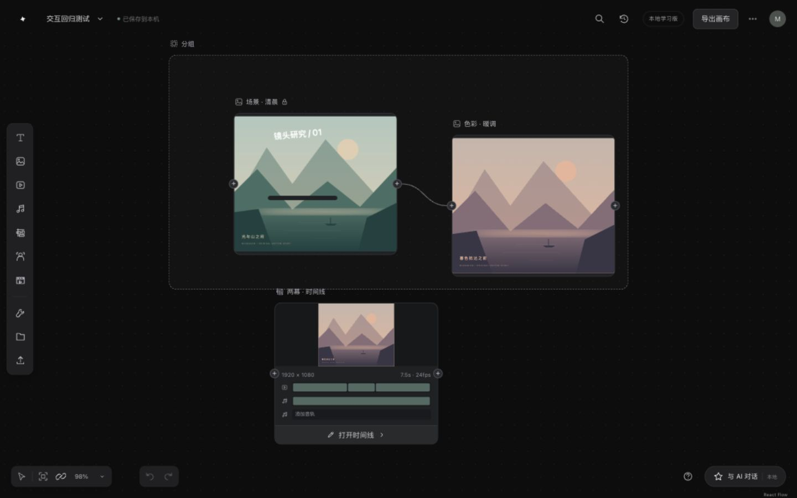

# OpenDesign · 本地创作画布

运行应用只保留画布，打开根地址即可恢复最近的本地项目。研究材料来自 [即梦首页](https://jimeng.jianying.com/ai-tool/home) 与 [画布编辑器](https://jimeng.jianying.com/ai-tool/ai-canvas)，资源采集日期：2026-10-26。

这个分支把浏览器发布的前端资源整理成可以阅读、追溯和继续开发的工程，包含两条学习路径：

- **实际代码恢复**：`research/capture/` 保存公开 JS/CSS 的原始字节、URL 和 SHA-256；`recovered/` 保存 Wakaru 解包、格式化与有限反编译的派生模块。依赖关系、未解决项和覆盖范围都有报告。
- **可运行的学习重建**：`src/` 是重新编写的 React + TypeScript 工程，提供全屏画布、时间线、图层板和 3D 导演预演。`bannerSnapshot.ts` 依据真实模块移植校验语义，其余 UI、类型、画布与插图均为重建。
- **本地生成服务**：`apps/api` 与 `packages/core` 是从 `main` 移植的 MuseShow 本地 API（FastAPI）。画布通过它调用你自己接入的模型：图片、视频、配音生成和 AI 助手。

没有获取到原站发布前的 TypeScript/TSX、原始 source map、构建配置、完整素材或服务端。**这不是完整原版工程，也没有连接即梦的生成服务。** 解包得到的源码不自动等于可编译的原站应用；可直接运行的是 `src/` 学习工程。真实生成只经由本地 API 调用“模型接入”中配置的模型。



画布实现与覆盖范围见 [画布导读](docs/CANVAS.md)。本轮通过已登录原站完成的 AI 测试、参数、花费与未覆盖项见 [实测记录](docs/AI-LIVE-TESTS.md)。

## 启动

需要 Node.js **24.22.1 或更新版本**，版本见 `.nvmrc`。依赖已锁定。

```sh
git clone --branch rea --single-branch https://github.com/ThinkFlowLab/OpenDesign.git
cd OpenDesign
npm ci
npm run dev
```

项目保存需要下方的本地 API；推荐使用 `scripts/museshow.py dev` 一起启动。打开终端显示的本机地址（默认 `http://127.0.0.1:5173`），应用直接打开画布；旧的 `/ai-tool/home` 地址也进入画布。单击左上角项目名称文本进入框内编辑，单击右侧箭头展开项目列表；名称框随当前文字宽度自动伸缩，不设置最小长度，Enter 或失焦保存、Esc 取消；保存失败会保留输入并提示错误。列表底部“新建画布项目”继续弹窗输入名称。首次没有项目时自动创建“未命名画布”。“更多”菜单中的“打开示例画布”提供可编辑的节点和参考连线。

只运行前端且没有本地 API 时，会提示连接服务；不会回退到浏览器工程或显示保存成功。生成面板继续保留“任务草稿/导入结果”流程。

### 连同本地生成服务启动

还需要 Python **3.11+**，以及在 PATH 中的 `ffmpeg` 和 `ffprobe`。

```sh
npm ci
python3 -m venv .venv
.venv/bin/python -m pip install -r requirements.txt
npm run build
.venv/bin/python scripts/museshow.py serve            # http://127.0.0.1:8000
# 或开发模式：API + Vite 热更新，打开 http://127.0.0.1:5173
.venv/bin/python scripts/museshow.py dev
```

端口被占用时追加 `--port 8001`。每个项目直接保存在 `projects/<项目名>/`，当前画布保存在其中的 `opendesign-canvas.json`；重命名同步修改目录名，项目 ID 保持不变。模型配置保存在 `.museshow/`（目录均已加入 `.gitignore`）。项目文件是权威数据，不再将完整画布另存 IndexedDB；浏览器只保留最近项目提示及现有任务历史等状态。该保存入口暂时复用 MuseShow v1 工程，C03/C04 的 `/api/creation` 新对象格式仍按后续重构接入，不自动迁移旧浏览器工程。

## 接入模型

点击右上角“模型接入”（或“更多 → 模型接入”），按类别添加模型。URL 填服务的 `/v1` 地址，Model ID 填服务的 `--served-model-name`。

视频模型可以在接入表单中选择适配方式，并配置每档分辨率的可用时长、像素尺寸及默认值；生成面板根据配置联动，不需要逐个模型修改源码。已知模型可载入适配预设，支持扩展声明的服务可读取能力；未知模型不猜测输出规格。配置方法和声明格式见 [视频模型能力配置](docs/video-model-capabilities.md)。

| 类别 | 接口协议 | URL 示例 | Model ID 示例 |
|---|---|---|---|
| 对话 Agent | OpenAI 兼容（vLLM 等） | `http://127.0.0.1:8100/v1` | `Qwen/Qwen3-30B-A3B` |
| 图片生成 | OpenAI 兼容（vLLM-Omni） | `http://127.0.0.1:8210/v1` | `Qwen/Qwen-Image-2.1`（或 `Tongyi-MAI/Z-Image-Turbo`） |
| 视频生成 | vLLM-Omni 视频接口 | `http://127.0.0.1:8000/v1` | `MiniMaxAI/MiniMax-H3` |
| 音频生成 | OpenAI 兼容语音合成（vLLM-Omni） | `http://127.0.0.1:8220/v1` | `Qwen/Qwen3-TTS-12Hz-1.7B-CustomVoice` |
| 视觉分割 | vLLM-Omni 分割接口（SAM 3） | `http://127.0.0.1:8230/v1` | `facebook/sam3` |
| 图片 / 视频 / 音频 | 火山方舟 / Agent Plan | `https://ark.cn-beijing.volces.com/api/plan/v3` | `doubao-seedream-5.0-pro` 等 |

接入后，在图片、视频或音频节点的生成面板中，从“本地服务”分组选择模型并提交。参考素材取自连到该节点的上游节点，结果作为新节点连接到来源节点，进度和失败原因显示在“生成历史”中，可随时取消。参数按模型的输入规则校验：

- **MiniMax-H3**：全能参考（图片与音频参考）、首帧（连接图片并选为首帧；不支持尾帧）、文生视频（不连接素材），以及**接续**：连接一段由同一 H3 服务生成的视频，新片段从它的结尾继续，画面和声音连续。接续依赖服务端缓存的潜变量（vLLM-Omni 的跨请求接续，见 [vllm-project/vllm-omni#9342](https://github.com/vllm-project/vllm-omni/pull/9342)），服务重启或缓存淘汰后需重新生成上一段。时长 4–15 秒，按 H3 的 17 帧组取整。
- **Qwen-Image-2.1**：文生图与指令编辑一体，1344×768，可直接作为 H3 首帧；可连接最多 4 张参考图片（人物、商品、风格），连接的文本节点会并入提示词。
- **Z-Image-Turbo**：只按文字出图，1344×768；连接的文本节点会并入提示词。
- **自部署语音合成**：朗读提示词中的文字。“音色”填服务支持的说话人（如 Qwen3-TTS 的 `vivian`、`serena`），留空使用模型默认音色。

“与 AI 对话”在接入对话 Agent 后连接本地 API 的助手：它可以构思剧本、将分镜设想保存为文本，并调用已接入的图片、视频和配音模型生成素材。助手写下的文档和生成的素材会自动加入当前画布；画布关闭期间完成的结果，会在再次打开该画布或点击“同步本地服务结果”时加入。

运行服务已移除 MuseShow 旧分镜板、旧分镜驱动时间线、旧制作计划及其专属导出与审阅链路，助手不再提供这些工具。OpenDesign 的本地时间线、浏览器 MP4 合成、全部高级编辑器、模型接入与任务恢复继续保留；制作台暂不实现。此轮清理没有改变当前 IndexedDB 画布和后端生成项目的存储方式，统一项目存储属于后续重构。

清理范围与验证见 [旧运行链路清理记录](docs/RUNTIME-CLEANUP.md)，后续工作见 [重构需求](OPENDESIGN_REFACTOR_REQUIREMENTS.md) 与 [实施计划](OPENDESIGN_REFACTOR_COMMIT_PLAN.md)。

C02 已定义新工程的共享节点、角色、素材、模型、任务和命令契约，并从 Python 自动生成 JSON Schema 与前端类型。当前运行入口尚未切换，使用方法和后续边界见 [统一创作契约](docs/CREATION-CONTRACTS.md)。

C03 已增加新工程文件存储、幂等命令回执、变更摘要和中断恢复，通过独立 `/api/creation` 接口提供创建、读取、打开及重命名。当前画布仍使用原入口；目录、接口和恢复规则见 [统一工程存储](docs/CREATION-STORAGE.md)。

C04 已增加流式上传、稳定素材入库、文本版本、真实媒体读取和文件提交恢复，供后续画布、模型及编辑器共用；默认入口尚未切换。接口、来源与验证范围见 [统一素材存储](docs/CREATION-ASSETS.md)。

自部署连接与长视频任务：

- FastH3 视频时长优先采用面板选定的 4–15 秒，并同时写入任务回执和服务请求的 `seconds`、`extra_params.duration`。只有未提供面板/API 时长的旧调用，才沿用提示词推断、编辑时保留原片长度或默认 5 秒的行为。显式选择时长的视频编辑不会再按原片长度裁剪；模型输出按自身帧数网格取整，可能存在少量时长差异。

- 视频节点的“生成参数”提供分辨率选择，并随请求保存、恢复。FastH3 / 原生 H3 提供“自动 / 480P / 768P”；横屏原生尺寸分别为 832×480、1344×768，竖屏交换宽高，其他画幅按模型的 32 像素网格对齐。参考生成沿用参考视频或图片的画幅；接续保留上一段尺寸，仅使用“自动”。旧画布的“自动”保持原行为，FastH3 默认仍为 480P。原生尺寸依据 [FastH3 配方](https://github.com/vllm-project/vllm-omni/blob/main/recipes/FastVideo/FastH3-Omni.md)。
- 火山 Seedance 2.0 接口提供 480P / 720P / 1080P / 4K，图片参考模式隐藏并拒绝 1080P，具体调用权限仍由服务账户决定。未知适配器只显示“自动”，不将其他模型的档位套用到它。能力依据 [Seedance 输出规格](https://docs.volcengine.com/docs/ark/video-generation-tutorial?lang=zh)及[参考模式限制](https://docs.volcengine.com/docs/lake-ai-service/video-generation-enhanced-edition-basic-edition?lang=zh)。

- 连接方式选择“自部署服务”时，后端直接连接配置的服务地址，绕过系统 HTTP/HTTPS 代理；适用于 VPN、局域网和可直接访问的公网服务，不绑定特定 IP。普通 API 连接和不同来源的结果 CDN 仍遵循原代理设置。网络本身仍须可达；只能通过 HTTP 代理访问的服务应选择 API 连接方式并指定相应协议。
- 同一个 OpenDesign 后端内，相同服务 URL 的 vLLM-Omni 视频任务串行执行，后续任务保留“排队”状态，不占用其他服务的执行名额。不同电脑和不同应用之间仍由服务器统一排队。
- 此类视频任务的执行等待上限为 4 小时，排队时间不计入；单次 HTTP 请求仍有连接/读取超时保护。超时或断线后保存原任务 ID，不自动重新生成。在“生成历史”点击“继续查询原任务”可恢复查询或下载；仍在执行的中断任务也可请求取消。
- 提交结果不明且没有服务器任务 ID 时，保留人工核对状态；不会将不确定的提交自动重发。修改服务 URL、模型或协议后，也不能把旧任务恢复到另一服务。

### 节点 AI 工具

选中图片或视频节点后，工具栏中的 AI 工具（扩图、消除、抠图、智能改图、多角度、智能打光、720 全景、图像预设、智能多尺寸、商品替换、智能超清、动态海报、视频编辑、视频局部重拍、字幕擦除、分离音轨、视频超清、补帧）由本地 API 执行，结果作为新节点连接到来源节点，进度显示在“生成历史”中，刷新页面后会继续跟进。工具只依赖“能力”，不依赖具体模型：

| 能力 | 当前由谁提供 | 用到它的工具 |
|---|---|---|
| 图生图 / 图片编辑 | Qwen-Image-2.1（指令编辑，最多 4 张条件图）、Z-Image-Turbo（`strength` 重绘）、OpenAI Images | 扩图、消除、智能改图、多角度、打光、全景、预设、多尺寸、商品替换、专业超清 |
| 主体抠图 | Qwen-Image-2.1（RGBA 输出） | 抠图（自动识别主体，涂抹可限定范围） |
| 图像分割 / 视频抠像 | SAM 3（vLLM-Omni `/v1/images/segmentations`、`/v1/videos/segmentations`） | 图层分解（智能 / 框选 / 按描述，背景由图片编辑模型补全）、视频抠像（黑 / 绿 / 透明背景，透明输出 WebM） |
| 首帧生视频 | MiniMax-H3 | 动态海报 |
| 视频局部重绘 | MiniMax-H3（vLLM-Omni 潜空间蒙版编辑：上传源视频与画面/声音蒙版，只重绘蒙版部分） | 视频编辑（按描述重绘框选区域）、局部重拍（只重绘所选时间段的画面和声音）、字幕擦除（默认底部字幕带，可拖动选框，声音保留）；超过 15 秒的视频分段处理。蒙版重绘不能整体换风格。视频提示词在接入对话模型时会先译成英文，并用负面提示词排除字幕，避免 H3 把中文渲染成字幕 |
| 无（本地 Pillow / ffmpeg） | — | 普通超清、视频超清、补帧、分离音轨（完整音轨与无声视频；人声/背景声为滤波近似），以及各工具的扩边、蒙版合成、截帧与拼接 |

缺少某种能力时，工具会显示“需要接入具备「图像分割」能力的模型”等原因，不会伪造结果；目前深度动作捕捉，以及分离音轨的音效/按描述分离属于这一类。接入新模型只需在 `packages/core/src/museshow/integrations/model_adapters.py` 中为它声明能力并实现对应请求，工具配方（`application/tool_operations.py`）无需改动。效果取决于接入的模型：Qwen-Image-2.1 按指令局部修改并保持人物一致；Z-Image-Turbo 是文生图模型，图生图会整体重绘。

```sh
npm test                 # 快照、画布命令/历史/持久化边界、本地服务输入规则与任务测试
.venv/bin/python -m pytest tests   # 本地 API、画布、生成、助手、模型与任务恢复测试
npm run build            # TypeScript 检查 + Vite 生产构建
npm run preview          # 查看生产构建
npm run recovery:check   # 核验原文件/派生文件/映射完整性及静态依赖
```

## 可以研究什么

- 本地素材：画布素材与项目保存在 IndexedDB，刷新可恢复，支持跨项目搜索和复制媒体，均不上传。
- 画布：无限平移、8%–800% 缩放、小地图、参考连线、文本/图片/视频/音频/文件/分组、框选、拖拽、缩放节点、编组、复制粘贴、锁定、层级、撤销重做。
- 图片编辑：真实像素裁剪、旋转、翻转、调色、图层合成、文字/形状、局部擦除、标注、蒙版、网格拆图与 PNG 输出。
- 媒体编辑：视频取帧、时长与画幅裁剪、保留音轨的 WebM 重编码、音轨提取和 WAV 输出；录制结果可再次编辑，见 [画幅裁剪](docs/VIDEO-CROP.md)。
- 时间线：素材快照、多音轨、源出入点、分割、裁剪、速度/音量、预览、JSON 交换和本地 H.264/AAC MP4 合成；主体与堆叠有独立编辑器。
- 导演预演：Three.js 基本物体、变换、镜头位置/目标/视野、关键帧播放、四种关节人偶动作、PNG 截图与 720p MP4 预演。用法与限制见 [独立创作功能](docs/LOCAL-CREATION.md)。
- 项目与生成器：本地项目切换、JSON 导入导出、搜索、媒体播放、模型/模式/比例/数量/镜头风格参数、引用素材、任务草稿与真实结果导入。
- 源码对照：SSR 推荐卡片快照校验、首页入口与异步资源分组、原始生成器的提交/中止边界。

首页 UI 和模拟生成任务已移除，历史采集与恢复材料仍保留用于研究。画布默认生成按钮已改为准备任务：导出请求、打开原站、导入真实媒体结果，并保留来源连线。学习工程没有连接即梦生成服务；原站 AI 实测与本地功能验收分别记录。原站资源只作为分析输入，应用不加载或执行 `recovered/` 与 `research/` 下的脚本。

## 目录

```text
src/
  App.tsx                 画布加载入口
  canvas/                 全屏编辑器、节点、历史、持久化、图片编辑、生成面板与助手
  backend/                本地 API 客户端：模型接入、生成任务、助手对话与结果同步
  domain/bannerSnapshot.ts 依据 TJ 模块移植的校验逻辑
  styles/                 全局基础样式
apps/api/                 本地 API（FastAPI）路由与对话流
packages/core/            项目、素材、画布、生成任务、助手与模型适配器
scripts/museshow.py       同时启动本地 API 与前端
tools/fasth3/             FastH3 远程部署工具
tests/                    前端 *.test.ts 与本地 API test_*.py
research/capture/         148 份原始公开资源和采集清单
research/prepared/        AST 提取的解包输入及原始区间
research/canvas/          独立 octo_web 画布资源、格式化代码与证据
recovered/                实际解包模块、派生 source map 和恢复报告
scripts/recovery*.mjs     可重复执行的恢复与核验工具
docs/                     工程导读与溯源说明
```

从 [源码对照指南](docs/SOURCE-MAP.md) 开始，再阅读 [工程导读](docs/ARCHITECTURE.md) 和 [恢复报告](recovered/README.md)。恢复结果的精确统计以生成报告为准，未知项不会被计为成功。

浏览器交互与构建验证范围见 [验证记录](docs/VALIDATION.md)。

## 重新执行恢复

```sh
npm run recover
npm run recovery:check
```

脚本基于已保存的公开资源执行静态分析，不联网补抓资源，不运行目标网站。使用 Wakaru 1.14.0 与 Babel parser；Wakaru 生成的 source map 指向发布包或其精确子区间，**不是原站的 TypeScript source map**。具体选项、输出范围和已知局限见恢复报告。

本次在 macOS 直接使用 Wakaru CLI。REA 用于前一阶段的静态分析；没有将本次恢复宣称为 REA 的 Linux source-recovery 适配器执行结果。

## 数据与权属

此分支只包含无需登录即可请求的公开 JS/CSS 及其派生结果、独立编写的学习代码和说明。不包含已登录 HTML、Cookie、浏览器配置、账号数据、API 响应或本机 REA 配置。原资源中的第三方版权/许可证标记保留；这里不把第三方资源重新授予开源许可证。请按原有权利范围使用研究材料。

`rea` 是独立学习分支；本地 API 从 `main` 移植，`main` 本身没有修改。
