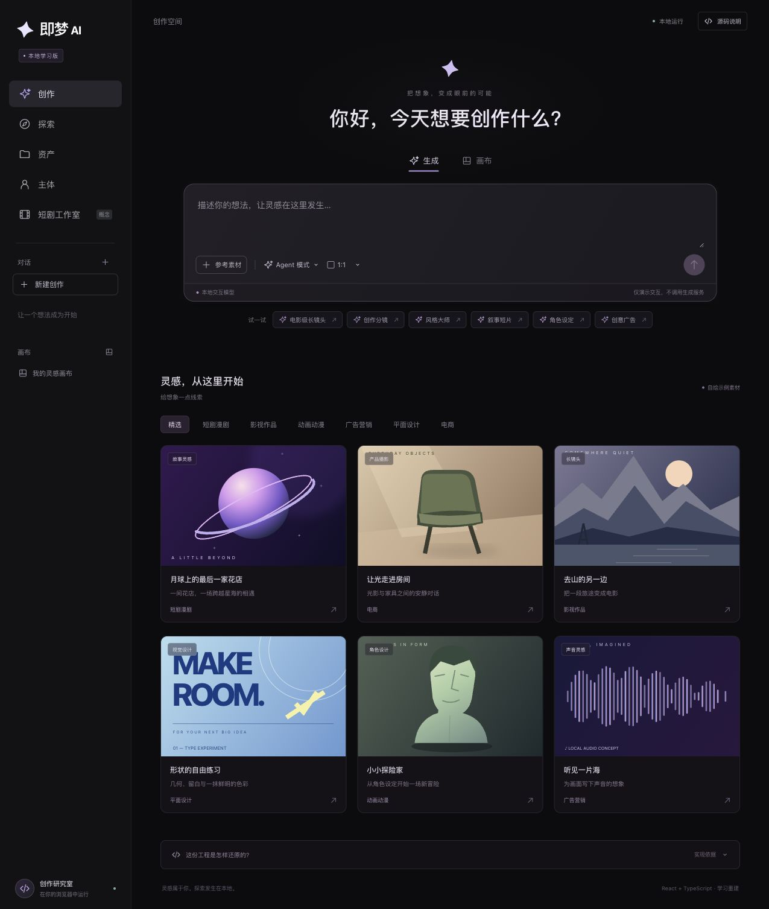

# MuseShow · 即梦前端学习工程

目标页面：[即梦首页](https://jimeng.jianying.com/ai-tool/home)。资源采集日期：2026-10-26。

这个分支把浏览器发布的前端资源整理成可以阅读、追溯和继续开发的工程，包含两条学习路径：

- **实际代码恢复**：`research/capture/` 保存公开 JS/CSS 的原始字节、URL 和 SHA-256；`recovered/` 保存 Wakaru 解包、格式化与有限反编译的派生模块。依赖关系、未解决项和覆盖范围都有报告。
- **可运行的学习重建**：`src/` 是重新编写的 React + TypeScript 工程，复现首页的组件分区和主要交互。`bannerSnapshot.ts` 依据真实模块移植校验语义，其余 UI、类型、画布、插图与本地任务适配器均明确标为重建。

没有获取到原站发布前的 TypeScript/TSX、原始 source map、构建配置、完整素材或服务端。**这不是完整原版工程，也不具备真实 AI 生成能力。** 解包得到的源码不自动等于可编译的原站应用；可直接运行的是 `src/` 学习工程。



## 启动

需要 Node.js **24.22.1 或更新版本**，版本见 `.nvmrc`。依赖已锁定。

```sh
git clone --branch rea --single-branch https://github.com/wuzhf9/MuseShow.git
cd MuseShow
npm ci
npm run dev
```

打开终端显示的本机地址（默认 `http://127.0.0.1:5173`）。

```sh
npm test                 # 快照校验、任务提交和中止测试
npm run build            # TypeScript 检查 + Vite 生产构建
npm run preview          # 查看生产构建
npm run recovery:check   # 核验原文件/派生文件/映射完整性及静态依赖
```

## 可以研究什么

- 首页：侧栏导航、生成/画布切换、创作类型、画幅、提示词、技能填入、灵感分类与卡片预览。
- 状态管理：提交 → 运行 → 完成/中止、取消控制器、资产列表和任务重用。
- 本地素材：选取参考文件、图片预览和移除；文件只留在当前页面，不上传，刷新即清空。
- 画布：本地概念示例，用来练习元素选择、移动、缩放和删除，具体支持项以界面为准。
- 源码对照：SSR 推荐卡片快照校验、首页入口与异步资源分组、原始生成器的提交/中止边界。

页面中显示“本地模拟”。任务完成后的卡片使用本工程绘制的 SVG，既没有调用即梦 API，也没有连接模型。原站资源只作为分析输入，学习应用不加载或执行 `recovered/` 与 `research/` 下的脚本。

## 目录

```text
src/
  App.tsx                 页面状态与任务生命周期
  components/             侧栏、输入区、卡片、画布、结果列表
  data/presets.ts          独立编写的提示词和样例内容
  domain/bannerSnapshot.ts 依据 TJ 模块移植的校验逻辑
  domain/generation.ts     独立编写的本地任务适配器
  styles/                 响应式界面样式
tests/                    领域边界与取消行为测试
research/capture/         148 份原始公开资源和采集清单
research/prepared/        AST 提取的解包输入及原始区间
recovered/                实际解包模块、派生 source map 和恢复报告
scripts/recovery*.mjs     可重复执行的恢复与核验工具
docs/                     工程导读与溯源说明
```

从 [源码对照指南](docs/SOURCE-MAP.md) 开始，再阅读 [工程导读](docs/ARCHITECTURE.md) 和 [恢复报告](recovered/README.md)。恢复结果的精确统计以生成报告为准，未知项不会被计为成功。

浏览器交互与构建验证范围见 [验证记录](docs/VALIDATION.md)。

## 重新执行恢复

```sh
npm run recover
npm run recovery:check
```

脚本基于已保存的公开资源执行静态分析，不联网补抓资源，不运行目标网站。使用 Wakaru 1.14.0 与 Babel parser；Wakaru 生成的 source map 指向发布包或其精确子区间，**不是原站的 TypeScript source map**。具体选项、输出范围和已知局限见恢复报告。

本次在 macOS 直接使用 Wakaru CLI。REA 用于前一阶段的静态分析；没有将本次恢复宣称为 REA 的 Linux source-recovery 适配器执行结果。

## 数据与权属

此分支只包含无需登录即可请求的公开 JS/CSS 及其派生结果、独立编写的学习代码和说明。不包含已登录 HTML、Cookie、浏览器配置、账号数据、API 响应或本机 REA 配置。原资源中的第三方版权/许可证标记保留；这里不把第三方资源重新授予开源许可证。请按原有权利范围使用研究材料。

`rea` 是独立学习分支；本次没有合并或修改 `main` 的 MuseShow 应用。
