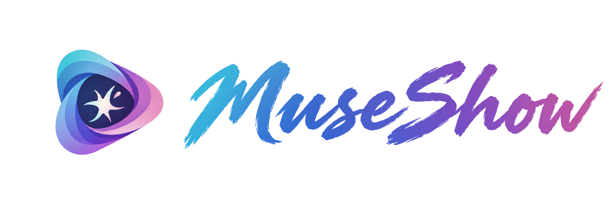

<p align="center">
  
</p>

MuseShow 是一个在本地运行、通过浏览器使用的 AI 视频创作工具。你可以与助手对话生成剧本和素材，在画布中管理内容，用分镜板组织镜头，并在时间线预览、导出短片。

## 环境要求

- Node.js：`20.19+`（20.x）、`22.12+`（22.x）或更高的受支持版本，附带 npm。
- Python：`3.11+`。
- FFmpeg：将 `ffmpeg` 和 `ffprobe` 加入 PATH，用于视频、音频处理及成片导出。
- 网络：安装依赖及调用模型服务时需要联网。

## 安装与启动

克隆或下载本仓库后，在仓库根目录按操作系统执行以下命令。

### macOS、Linux 和 WSL

```bash
npm --prefix apps/web ci
python3 -m venv .venv
.venv/bin/python -m pip install -r requirements.txt
npm --prefix apps/web run build
.venv/bin/python scripts/museshow.py serve
```

### Windows（PowerShell）

在仓库根目录打开 PowerShell，依次执行：

```powershell
npm.cmd --prefix apps/web ci
py -3 -m venv .venv
.\.venv\Scripts\python.exe -m pip install -r requirements.txt
npm.cmd --prefix apps/web run build
.\.venv\Scripts\python.exe scripts/museshow.py serve
```

打开 <http://127.0.0.1:8000/> 开始使用，保持启动终端运行，按 `Ctrl+C` 停止。下次使用只需执行对应系统的最后一条 `serve` 命令；更新源码后，请重新安装依赖、构建并重启。

端口被占用时，在对应系统的 `serve` 命令后追加 `--port 8001`，并访问 <http://127.0.0.1:8001/>。

## 配置模型

点击左下角设置按钮，进入“模型接入”，分别为 **Agent、图片生成、视频生成、音频生成**添加模型。每个模型填写 **URL、API Key、Model ID**；同一类别可添加多个模型，并在右侧助手的模型选择器中切换。

Agent 支持 OpenAI Chat Completions 兼容服务（含自部署的 vLLM）；图片、视频和语音支持火山引擎 Agent Plan，视频还支持自部署的 vLLM-Omni MiniMax-H3（音画同出），图片还支持自部署的 vLLM-Omni Z-Image-Turbo。配置示例：

| 类别 | URL 示例 | Model ID 示例 |
|---|---|---|
| Agent | `https://api.deepseek.com` | `deepseek-flash` |
| 图片生成 | `https://ark.cn-beijing.volces.com/api/plan/v3` | `doubao-seedream-5.0-pro` |
| 视频生成 | `https://ark.cn-beijing.volces.com/api/plan/v3` | `doubao-seedance-2.0` |
| 音频生成 | `https://openspeech.bytedance.com/api/v3/plan` | `doubao-seed-tts-2.0` |
| 视频生成（vLLM-Omni） | `http://<服务地址>:8000/v1` | `MiniMaxAI/MiniMax-H3` |
| 图片生成（vLLM-Omni） | `http://<服务地址>:8000/v1` | `Tongyi-MAI/Z-Image-Turbo` |

请使用自己账户可用的模型和密钥，调用费用由模型服务商收取。密钥保存在本机，请妥善保管。火山引擎配置可参考官方[视觉模型说明](https://docs.volcengine.com/docs/ark/agent-plan-personal-visual-models?lang=zh)和[语音模型说明](https://docs.volcengine.com/docs/ark/agent-plan-personal-voice-model?lang=zh)。其他厂商的媒体服务需单独支持。

vLLM-Omni 按 Model ID（即服务的 `--served-model-name`，末段为 `MiniMax-H3`）识别，URL 填服务的 `/v1` 地址；服务未开启鉴权时 API Key 可填任意非空值。H3 支持首帧、素材参考和**接续上一段**三种方式：接续时引用一段由同一 H3 服务生成的视频，新片段从它的结尾继续生成，画面和声音保持连续，结果只包含新内容，可直接接在时间线上一段之后。接续依赖服务端缓存的上一段潜变量，服务重启或缓存淘汰后需重新生成上一段；制作计划中给后一个镜头选择接续，即自动接续前一个镜头的视频。

vLLM-Omni Z-Image-Turbo 按 Model ID（末段为 `Z-Image-Turbo`）识别，只按文字出图，输出 1344×768（与 H3 画幅一致，可直接作首帧）；文档参考会并入提示词，不接受参考图片。制作计划中关键帧会略过图片参考，角色一致性请在提示词中写明外貌和服装；同一镜头的视频步骤仍使用这些参考图片。

“设置 → 通用”中可切换浅色或深色主题，界面语言目前为中文。

“去除水印”默认开启，后续新建的图片、视频生成任务不添加“AI生成”可见水印；关闭后恢复添加。设置保存在本机，保存后立即生效。新建批量制作计划会固定当时的水印设置，继续或重试沿用原设置；旧计划仍按原有带水印方式执行。已创建的任务和已生成的资产不受切换影响，参考素材中已有的水印也可能保留在生成结果中。

## 开始创作

1. 在右侧选择模型并描述创作目标。首次发送消息会自动创建项目，也可手动新建。
2. 明确要求开始制作，例如：“请制作四个镜头的雨后清晨短片，每镜生成关键帧、视频和中文旁白。”
3. 在制作进度中查看结果，到画布调整素材，在分镜板确认采用。
4. 打开时间线预览，点击“导出视频”，填写文件名后下载 MP4。

单个制作计划最多支持 12 个镜头。可要求助手“只重做第二镜旁白，保留画面”，或“保留当前版本，只生成候选”；候选需确认采用才会进入成片。制作受阻时，已有成果保留，可按提示核对任务并“按原设置继续”。

部分镜头未完成时，可在时间线预览已就绪镜头；完整导出需补齐必要素材。

## 手动制作与调整

### 画布：创建与管理素材

- **创建节点**：双击、右键画布或使用底部工具栏添加文本、图片、视频、音频节点。空白节点可直接填写要求并生成，也可“上传为节点内容”。上传或保存手动文本后成为素材节点，可替换同类型文件；提交生成后成为生成节点，通过修改要求和参考生成新版本。
- **添加参考**：在聊天或节点输入框中上传、粘贴、拖入文件，或输入 `@` 选择项目资产，参考会插入正文。上传的参考先保存在资产列表，按需显示到画布或“展开参考”；删除正文引用只解除引用，不删除文件。`@` 面板支持 ↑↓ 选择、←→ 分类、Enter 插入、Esc 关闭。
- **查看与编辑**：悬停节点或点击三点按钮打开详情。文本双击编辑或查看，图片双击放大；视频悬停静音预览、双击完整播放；音频点击播放按钮播放。
- **选择与移动**：拖动空白处框选，`Shift` 追加选择；拖动节点可整组移动，`Delete`／`Backspace` 移除选中节点并保留文件。选择后可点击助手正文，将“待插入”参考插入光标处；点击外部或按 `Esc` 取消插入。
- **导航与排版**：切换“平移”模式或按空格拖动画布，用工具栏或 `Ctrl`／`Command` + 滚轮缩放；“整理画布”按类型排版，“全局视图”显示全部节点。
- **版本与撤销**：“历史版本”展示每版素材、模型及原始要求和参考；“应用到画布”恢复该版展示和生成输入，参考跟随来源当前版本，已有分镜采用不变。底部撤销／重做支持最近 50 步画布编辑，快捷键为 `Ctrl`／`Command` + `Z`、`Ctrl`／`Command` + `Shift` + `Z`；输入框内优先撤销文字编辑，模型任务和生成结果不回退。
- **资产列表**：按名称及“全部／已使用／未使用”筛选，预览、显示到画布或批量删除。历史版本在节点中查看；永久删除会检查引用，必要时需确认清空画布撤销记录。

参考可使用项目来源的当前版本，无需先显示到画布；历史候选需先应用为当前版本。助手读取文本和图片内容，视频、音频仅提供素材信息；除 H3 接续上一段外，不支持视频文件作为生成参考。Seedream 5.0 Pro 最多支持 10 张参考图；Seedance 2.0 首帧模式使用一张图片，素材参考模式最多使用 9 张图片和 3 段 WAV／MP3 音频，音频须搭配图片且总时长不超过 15 秒。具体限制按模型与模式检查。

支持 TXT、Markdown、常见图片、视频和音频；单文件最多 50 MB，UTF-8 文本最多 1 MB。图片默认生成 2K，视频默认 5 秒并带音轨；语音使用固定中文音色，输入框仅填写朗读正文，暂不支持音乐、音效或声音克隆。

### 分镜板：组织镜头与选择素材

- 新增、插入、复制、排序或移除镜头；点击卡片编辑标题、画面描述并关联项目素材，修改自动保存。
- 每镜采用一份图片或视频作为主画面，可另选一份旁白。切换候选仅预览，点击“采用为主画面”或“采用旁白”才生效。
- “保留视频原声”独立于旁白设置；需要修改素材时，点击“到画布查看”。

### 时间线：预览与导出

- 自动同步分镜顺序和已采用素材，显示画面、视频原声、旁白三条轨道；点击画面播放／暂停，点击时间尺跳转，可分别静音声音轨道或片段。
- 视频按完整时长播放；图片默认停留 3 秒，可选中片段修改时长。旁白从镜头起点播放，超出镜头的部分截断并提示。
- 点击“导出视频”保存 MP4，输出为 1280×720、30 fps，保持画面比例并补黑边。“导出记录”可再次下载或重试。

目前暂不支持自由裁剪、转场、背景音乐或字幕编辑。

## 保存与恢复

项目保存在仓库根目录的 `projects/` 中，首次创建项目时自动建立。左侧项目列表读取该目录；关闭项目后可重命名，对应文件夹会同步改名。制作或导出期间请等待完成后再重命名。备份项目时请保留完整项目文件夹。

生成任务在关闭页面或切换项目后仍可继续。停止助手回复不会停止已开始的制作；“停止后续制作”用于停止后续步骤，“取消已提交任务”用于请求取消已提交的生成，结果请在节点中查看。

保存失败时界面会保留当前输入，请先重试或处理提示后再切换。服务重启后，查看制作进度并按提示核对、继续。

无法连接本地服务时，请检查启动终端，并使用上述 `serve` 或下方 `dev` 命令完整启动应用。媒体处理失败时，可在终端运行 `ffmpeg -version` 和 `ffprobe -version` 检查安装，安装后重启应用。

## 修改源码时运行

如需边修改界面边预览，完成依赖安装后，在仓库根目录按操作系统执行：

### macOS、Linux 和 WSL

```bash
.venv/bin/python scripts/museshow.py dev
```

### Windows（PowerShell）

```powershell
.\.venv\Scripts\python.exe scripts/museshow.py dev
```

打开 <http://127.0.0.1:5173/>。网页修改自动更新，Python 修改后需重启。端口冲突时，在对应系统的 `dev` 命令后追加 `--port 8001 --web-port 5174`，并访问 <http://127.0.0.1:5174/>。
