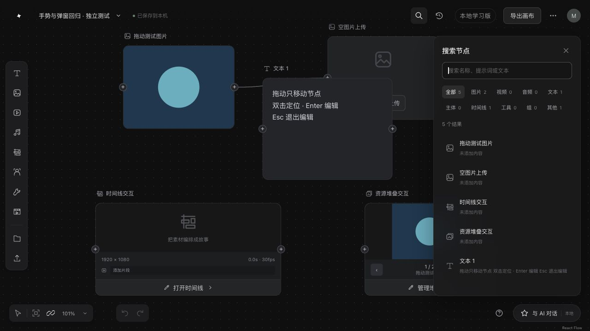
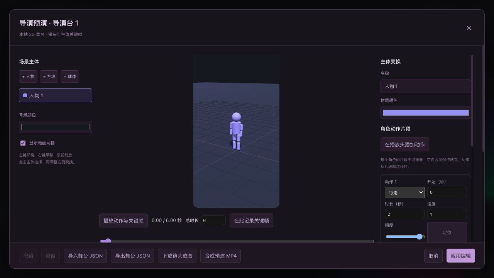

# 画布未覆盖模块对照审查

日期：2026-10-27。基线：OpenDesign `rea` 的 `ed9bb7fb`；下文明确区分本轮修复与仍然欠缺的能力。

本轮重点不重复先前的拖动、基础连线、背景点、生成动画和工具栏提示检查。新增检查搜索、历史、标签、端口能力、资源栈、素材导入、时间线素材库与工程导出、主体、导演台、助手和项目管理。

**初次审查记录 22 项差异，其中 3 项当时修复。后续已实现其余 19 项的本地功能与修复，最新验收见文末「待处理项修复验收」。** 这不是全站穷举，也不代表每个未修项都已经在浏览器复现。此前已知的云账号、跨设备同步与多人协作不重复计数。

## 证据范围

- **界面实测**：已登录 Brave 的即梦独立测试画布；本地独立 `localhost:5173` 项目。未调用 AI、上传个人文件或消耗积分。
- 原站搜索：空查询显示 4 个节点；输入“图片”后变为全部 1、图片 1，其他类别无结果；存在清空按钮及类别标签。
- 原站历史：当前测试项目显示空历史，存在全部/图片/视频/音频标签。历史分页、重新放置旧结果仅有发布包证据，本轮没有生成任务去测试它们。
- 原站节点标签：实际打开了青绿色、靛蓝色、紫色、橙色、黄色及全部清空工具栏；未更改现有标签。
- 原站主体：名称和描述在节点内部编辑，主素材入口包括导入主体、资产库与本地添加。本地仍用明确的独立编辑器。
- 原站时间线：实际进入全屏编辑，检查已导入资产/画布资产、类型分类、资产区与轨道区尺寸调整、自动吸附、缩放、分割和左右剪裁；展开导出菜单看到了 XML、批量素材、剪映、DaVinci Resolve、Premiere、Final Cut Pro。未执行这些外部导出。
- 原站导演台：首次加载较慢，随后成功进入。检查静态/动态预演、角色/物体/背景/机位、对象与属性面板、实时机位预览、时间轴缩放与分镜编排。动态切换有场景同步提示；选择不覆盖的切换路径，检查后直接关闭，没有保存云端场景。独立测试画布新增一个空导演台节点。
- **源码判断**：使用工程内保留的原站公开发布包与本地实现逐项比较。下列行号是本轮审查定位，后续修改应通过相邻符号再次定位。
- **生产函数验证**：循环连线、三视图约束、导演台取样值分离有本地纯函数执行证据；不等同于原站运行验证。窄屏导演构图问题仍是静态推断。

## 本轮已修复

| 编号 | 问题与修复                                                                                                                                                                                                                                        | 原站证据                                                                                                            | 验证                                                                                                                                                         |
| ---- | ------------------------------------------------------------------------------------------------------------------------------------------------------------------------------------------------------------------------------------------------- | ------------------------------------------------------------------------------------------------------------------- | ------------------------------------------------------------------------------------------------------------------------------------------------------------ |
| F01  | A→B 后仍能 B→A，长路径也能形成循环。由 `model.canAddReference` 统一端口预览与 `add-edge` 命令的自连、重复、端点和环路检查。旧文档的既有边不自动删除。                                                                                             | [canvas-data](../research/canvas/readable/js/04625fc43d5d-canvas-data.764f8a0821.js) `14867`，`creates_cycle`       | 生产命令测试直接/间接环路、合法汇入、旧循环；浏览器反向拖线维持 1 条，合法连接变为 2 条，撤销回到 1 条。                                                     |
| F02  | MIME 为空/通用二进制时，合法媒体被当成文件或拒绝。增加统一 `classifyImportFile`，主画布、时间线、主体、图层导入采用同一识别规则，生成的 data URL 也使用规范 MIME。具体 MIME 优先，只有缺省/通用类型才按已知扩展名回退；实际解码仍检查媒体有效性。 | [canvas-core](../research/canvas/readable/js/e02221c0211e-canvas-core.04e59616e1.js) `154311`                       | 文件名/MIME 冲突、无扩展名、大写后缀与缺省类型测试；生产读取函数配合浏览器加载器替身验证 data URL 和元数据一致。未模拟所有操作系统文件选择器的 MIME 返回值。 |
| F03  | 搜索缺类型筛选、计数、清空与空结果说明。增加统一搜索投影和有键盘导航的类别栏，关键词匹配标题、提示词、文本；本地文件归入“其他”。                                                                                                                  | 原站搜索实测；[canvas-core](../research/canvas/readable/js/e02221c0211e-canvas-core.04e59616e1.js) `56191` 分类投影 | 浏览器 5 节点计数、2 图片筛选、空结果、清空、关键词前后空格、方向键/Home、点击定位；查询与各类计数的一致性测试。未接原站远程资源内容检索。                   |

附带纠正了侧栏的“导演工具箱”旧标题，使其与实际提供的“媒体工具箱”一致。

## 初次审查差异：画布组织、素材与编辑

下表保留初次审查的问题描述与来源定位，当前实现状态以文末修复验收为准。

| 编号 / 类型        | 差异与最小检查路径                                                                                                                                                                   | 本地定位                                                                                                       | 原站证据                                                                                                                                                                                                                |
| ------------------ | ------------------------------------------------------------------------------------------------------------------------------------------------------------------------------------ | -------------------------------------------------------------------------------------------------------------- | ----------------------------------------------------------------------------------------------------------------------------------------------------------------------------------------------------------------------- |
| R01 / 能力规则     | 非 group 节点统一展示双向端口。stack 不应有端口，timeline 仅输入、tool 仅输出；还缺按目标能力约束来源类型。图片→stack 已通过本地命令验证会被接受。基础端口与模型动态能力应分开实现。 | [CanvasNodeView](../src/canvas/CanvasNodeView.tsx) `248`                                                       | [canvas-data](../research/canvas/readable/js/04625fc43d5d-canvas-data.764f8a0821.js) `14742` 端口及来源能力表                                                                                                           |
| R02 / 功能缺失     | 没有五色标签的持久化、多选三态或按标签查看成员。节点上的标签形图标实际打开普通节点选项。                                                                                             | [CanvasNodeView](../src/canvas/CanvasNodeView.tsx) `94`；[model](../src/canvas/model.ts) `CanvasNodeData`      | 原站标签工具栏实测；[canvas-core](../research/canvas/readable/js/e02221c0211e-canvas-core.04e59616e1.js) `131113`、`80739`                                                                                              |
| R03 / 功能缺失     | 生成历史主要在本次打开期间的 React state 中，切换项目会清空。历史点击只是定位仍存在的节点，不能从记录重新放置删除的旧结果。已有后端任务同步不等于完整保留本地草稿/导入记录。         | [CanvasWorkspace](../src/canvas/CanvasWorkspace.tsx) `jobs`、`setJobs([])`、`panel === "history"`              | [main](../research/canvas/readable/js/545ec3537fff-main.303f6eac20.js) `56333`；[canvas-core](../research/canvas/readable/js/e02221c0211e-canvas-core.04e59616e1.js) `7566`。云历史依赖服务端，本地历史可以独立持久化。 |
| R04 / 交互差异     | 创建资源栈后原成员仍独立显示、移动，连线没有折叠投影。原站成员折叠到栈内，内部边隐藏，外部边投影到栈呈现位置；不应简单改写成员持久父级。                                             | [operations](../src/canvas/operations.ts) `344`；[CanvasWorkspace](../src/canvas/CanvasWorkspace.tsx) 节点投影 | [canvas-core](../research/canvas/readable/js/e02221c0211e-canvas-core.04e59616e1.js) `144590`、`144655`                                                                                                                 |
| R05 / 交互缺陷     | 两成员资源栈移除一个后，“应用”被禁用，操作不能提交。应该支持移出，并在剩余不足 2 时解栈。                                                                                            | [StackEditor](../src/canvas/StackEditor.tsx) `65`                                                              | [canvas-data](../research/canvas/readable/js/04625fc43d5d-canvas-data.764f8a0821.js) `2204`、`2220`                                                                                                                     |
| R06 / 入口缺失     | 没有剪切及前移一层、后移一层、置底的完整菜单/快捷键；底层已支持四方向重排。检查 Cmd/Ctrl+X 与层级菜单。                                                                              | [CanvasWorkspace](../src/canvas/CanvasWorkspace.tsx) 键盘处理及节点菜单                                        | [main](../research/canvas/readable/js/545ec3537fff-main.303f6eac20.js) `63970`                                                                                                                                          |
| R07 / 素材保留缺陷 | 时间线“已导入”由当前片段派生。导入素材后删掉其最后一个片段，素材也从列表消失，必须重新选文件。应由独立持久素材列表拥有导入记录。                                                     | [TimelineEditor](../src/canvas/TimelineEditor.tsx) `117`、`355`                                                | [canvas-core](../research/canvas/readable/js/e02221c0211e-canvas-core.04e59616e1.js) `10699` 独立导入素材登记                                                                                                           |
| R08 / 批量操作缺陷 | 正常 PNG、坏 PNG、正常 PNG 一起导入时，外层异常使整批不提交，已成功读取的素材也丢弃。需要逐文件结果与成功项提交，仍保留取消/切换项目保护。                                           | [CanvasWorkspace](../src/canvas/CanvasWorkspace.tsx) `importFiles`                                             | [asset-library](../research/canvas/features/readable/async-canvas-asset-library-dialog.b4531e56ad.js) `452` 部分成功结果                                                                                                |
| R09 / 编辑能力     | 时间线按总时长把片段映射到 100% 宽度，没有独立时间轴缩放及自动吸附开关。长片段旁的短片段难以精调；还缺原站可调整的资产区/轨道区布局。                                                | [TimelineEditor](../src/canvas/TimelineEditor.tsx) `1109`、`1126`                                              | 原站全屏编辑实测；[timeline](../research/canvas/features/readable/async-canvas-node-timeline.d2642db961.js) `1883`                                                                                                      |
| R10 / 编辑能力     | 图片裁剪只有原始比例和预设比例，不能任意调整矩形宽高。例如从正方形裁 2:1。视频的自由裁剪已经实现，不能据此认为图片也已支持。                                                         | [ImageEditor](../src/canvas/ImageEditor.tsx) `50`、`455`                                                       | [canvas-core](../research/canvas/readable/js/e02221c0211e-canvas-core.04e59616e1.js) `125167`、`125243`                                                                                                                 |
| R11 / 工程交接     | 已有 MP4 和本工程时间线 JSON，但缺 XML、剪辑软件工程和批量素材打包。原站云端导出接口不能直接当作本地实现，标准交换格式可另行实现。                                                   | [timeline](../src/canvas/timeline.ts) `219`                                                                    | 原站导出菜单实测；[canvas-core](../research/canvas/readable/js/e02221c0211e-canvas-core.04e59616e1.js) `43151`；[timeline](../research/canvas/features/readable/async-canvas-node-timeline.d2642db961.js) `1804`        |

## 初次审查差异：导演台、生成、助手与项目

| 编号 / 类型      | 差异与最小检查路径                                                                                                                                                                                                   | 本地定位                                                                                                                   | 原站证据                                                                                                                       |
| ---------------- | -------------------------------------------------------------------------------------------------------------------------------------------------------------------------------------------------------------------- | -------------------------------------------------------------------------------------------------------------------------- | ------------------------------------------------------------------------------------------------------------------------------ |
| R12 / 编辑缺陷   | 预览用当前时间采样，属性面板却读基础对象。0 秒位置 (0,0)、6 秒 (6,6)，3 秒画面是 (3,3)，面板仍为 (6,6)；只改 Y 为 4 会带回旧 X=6。纯函数已验证值分离，尚未浏览器复现整条编辑手势。应统一当前帧姿态的读取和提交边界。 | [DirectorStage](../src/canvas/DirectorStage.tsx) `219`、`269`、`489`                                                       | [导演台发布包](../research/canvas/features/readable/2232.9df5e1610c.js) `37999` 当前帧求值                                     |
| R13 / 参数缺陷   | 产品三视图可保留 9:16 等不匹配参数，`generationBlocker` 仍返回 null。之前 T12 实测是 16:9、2K、1 张；预设应该统一收紧模型、比例、清晰度、数量。这里只能确认已观察预设的本地约束，不能假设其他服务也支持该预设。      | [NodeComposer](../src/canvas/NodeComposer.tsx) `397`；[generationCatalog](../src/canvas/generationCatalog.ts) `263`        | [AI 实测 T12](AI-LIVE-TESTS.md)；[canvas-core](../research/canvas/readable/js/e02221c0211e-canvas-core.04e59616e1.js) `109114` |
| R14 / 编辑缺陷   | 导演台内部没有撤销/重做。删除角色或关键帧后不能局部撤销，只能取消整个编辑器；画布外层撤销不能替代内部历史。                                                                                                          | [DirectorStage](../src/canvas/DirectorStage.tsx) `270`；[EditorModal](../src/canvas/EditorModal.tsx) `61`                  | [导演台发布包](../research/canvas/features/readable/2232.9df5e1610c.js) `47012`                                                |
| R15 / 待实测风险 | 窄窗口预览使用容器实际比例，CSS 最小高度可能把 16:9 撑高；导出仍固定 16:9，可能改变边缘构图。仅静态推断，需窄屏截图和真实导出比对后定案。                                                                            | [director-stage.css](../src/canvas/director-stage.css) `51`；[DirectorStage](../src/canvas/DirectorStage.tsx) `347`、`657` | [导演台发布包](../research/canvas/features/readable/2232.9df5e1610c.js) `8307` 镜头画幅蒙版                                    |
| R16 / 编排能力   | 一个角色只有贯穿全片的单一动作，不能“前 2 秒走路、后 4 秒挥手”。缺少逐角色动作片段/区间轨，独立于外部 FBX 或原站角色库问题。                                                                                         | [stageMotion](../src/canvas/stageMotion.ts) `8`；[stageDocument](../src/canvas/stageDocument.ts) `25`                      | [导演台发布包](../research/canvas/features/readable/2232.9df5e1610c.js) `25610`、`25748`                                       |
| R17 / 编排能力   | 文档只有一个 camera，关键帧连续插值；无法保存多个机位并按片段硬切。原站静态/动态预演、实时机位小窗、分镜轨也未完整复刻。                                                                                             | [stageDocument](../src/canvas/stageDocument.ts) `31`、`279`                                                                | 原站动态预演和添加分镜入口实测；[导演台发布包](../research/canvas/features/readable/2232.9df5e1610c.js) `41930`、`28745`       |
| R18 / 前后端接线 | 助手请求固定 `assets: []`，组件不接选区，因此选中的图片不会作为本轮显式输入发送。已有本地 API 支持素材引用，应复用其契约；需要本地服务，不需要即梦服务。不能据此断言后端完全没有历史项目上下文。                     | [AssistantPanel](../src/canvas/AssistantPanel.tsx) `37`、`122`；[本地 chat API](../apps/api/src/museshow_api/chat.py) `62` | [main](../research/canvas/readable/js/545ec3537fff-main.303f6eac20.js) `34531`                                                 |
| R19 / 管理入口   | 项目列表只有新建/打开，缺复制、清理入口。`deleteDocument` 已实现但没有 UI 消费者。需要明确本地项目与关联 API 项目的删除范围，以及可恢复路径。                                                                        | [CanvasWorkspace](../src/canvas/CanvasWorkspace.tsx) `panel === "projects"`；[storage](../src/canvas/storage.ts) `377`     | [main](../research/canvas/readable/js/545ec3537fff-main.303f6eac20.js) `60336`、`60412`                                        |

## 不应误判为缺失的能力

- 本地已能导入图片、视频、音频并随项目保存，且已有跨项目素材复制；不是只有示例封面。
- 时间线已有分割、左右剪裁、重排、音轨放置、静音、倍速、撤销及真实 MP4 合成。此次缺的是上述精细控制与工程交换能力。
- 主体采用**保留快照**语义，明确允许原节点删除后素材仍保留；生成草稿携带完整 `subject`。原站的实时绑定边与本地不同，但仅缺一条可见连线不代表生成一定漏图。若改成实时绑定，应统一修改所有消费者并保留快照回退。
- 导演台已有原创关节人物、动作采样与真实视频导出。它没有等价实现原站的完整角色库、动作区间、多机位和分镜系统。

## 建议的处理顺序

1. 先修会导致编辑结果意外变化或操作无法提交的 R12、R08、R07、R05、R14，并落实 R13 的已观察参数约束。
2. 再补 R01、R02、R03、R04、R06、R18、R19，统一节点能力、关系和项目/历史的数据所有权。
3. 时间线缩放、吸附、自由裁剪、多机位、动作轨与工程导出按独立模块验收；R15 先做真实窄屏导出对照。

## 本轮验证与限制

- `npm test`：125 项通过（新增 6 项）；`npm run build`：TypeScript 与 Vite 通过。仍有画布约 511 kB、导演台约 569 kB 的构建块大小提示。
- 本地搜索和连线完成实际鼠标/键盘回归。干净测试会话 error/warn 为 0；早先开发页在新增文件尚未写完时保留过 Vite 热更新失败日志，未将其当作最终运行结果。
- MIME 缺省修复覆盖统一分类及生产读取边界；没有通过页面脚本伪造 File，也没有声称完成所有系统/浏览器的真实文件选择器组合。
- 未重新调用生成模型，未运行本轮未修改的 Python 服务测试，未验证多人协作、真实触屏、全部媒体格式、FBX 导入或所有剪辑软件导出。
- 本清单保留未修项与证据级别，不能据此宣称“全部前端功能已对齐”。

## 待处理项修复验收（2026-10-27）

基于 `2aa9b601` 继续完成 R01–R19 的本地实现。下列结论覆盖本工程；不表示原站云端能力或所有 UI 已完全等价。此次未发起 AI 生成、未消耗即梦积分。

| 编号 | 当前实现                                                                                                 | 验证证据                                                                                                                                      |
| ---- | -------------------------------------------------------------------------------------------------------- | --------------------------------------------------------------------------------------------------------------------------------------------- |
| R01  | 端口、来源类型、容量、循环和空白处建节点共用连接策略；编辑结果来源边与生成输入边分离。                   | 生产命令/首尾帧测试；浏览器时间线输入菜单只列图片、视频、音频。                                                                               |
| R02  | 五色标签、批量三态、清空、颜色筛选、持久化及撤销。                                                       | 命令、复制、持久化测试；浏览器加青色标签后刷新仍保留。                                                                                        |
| R03  | 按项目保存生成请求、结果快照、状态及任务 ID；类型过滤、多选重新放置、恢复请求节点。                      | 浏览器草稿→导入测试 PNG→刷新→重新放置；失去来源节点时仍可回放。纯函数检查快照独立与服务失败状态恢复。                                         |
| R04  | 栈成员在视图中折叠、内部边隐藏、外部边投影；隐藏成员定位和选区映射到栈壳。                               | 投影与复制测试；浏览器 9 个成员折叠为 1 张卡片，粘贴仍只选栈壳。                                                                              |
| R05  | 可移出成员；不足两个自动解散，也可显式解栈，保留原节点及边。                                             | 浏览器两成员移出一项→4 个剩余画布节点、原关系仍在；锁定与撤销回归。                                                                           |
| R06  | 剪切、四方向层级菜单及快捷键；剪切拥有完整组/栈，锁定保护时整次不执行。                                  | 浏览器菜单剪切 10 节点→0，粘贴→1 栈壳，解栈→9 成员；生产测试覆盖锁定成员。浏览器工具会接管 Cmd+X/V 的系统剪贴板，因此该路径使用应用菜单验收。 |
| R07  | 时间线独立导入库，删除最后一个片段不会删除素材；显式移出素材库另有入口。                                 | 浏览器导入→删片段→应用→等“已保存到本机”→刷新→已导入仍有 1 项；同 src、节点映射、序列化和撤销测试。                                            |
| R08  | 主画布和时间线逐文件读取，部分成功可提交，取消不提交半批。                                               | 浏览器正常 PNG、坏 PNG、正常 PNG 一批导入，成功 2 项并显示 1 项失败；取消测试。                                                               |
| R09  | 时间轴缩放、横滚、动态刻度、自动吸附及可调整素材区/轨道区。                                              | 浏览器缩放从 40 到约 753 px/s、关闭吸附；取样/吸附及库数据测试。                                                                              |
| R10  | 图片自由矩形裁剪、拖动位置、独立宽高、角点缩放，保留像素编辑与撤销。                                     | 浏览器拖动手柄，真实下载 PNG 为 281×110，与预览输出一致。                                                                                     |
| R11  | FCPXML 1.10、XML＋原媒体 ZIP、取消与错误处理；保留 JSON/MP4。                                            | 官方 Apple DTD 校验；真实浏览器 ZIP 下载后独立检查 CRC、XML 版本和全部相对媒体路径。                                                          |
| R12  | 面板与预览共用当前帧采样，局部属性编辑保留其他轴插值。                                                   | 浏览器 0/6 秒 X、Y 为 0/6，3 秒面板显示 3/3；只改 Y=4，X 仍为 3。                                                                             |
| R13  | 产品三视图固定已观察组合：Seedream 5.0 Pro、16:9、2K、1 张；不兼容控件禁用，旧/导入参数在提交前校验。    | 归一化、模型切换和不匹配参数拒绝测试；不代替其他模型 API 能力。                                                                               |
| R14  | 导演台独立撤销/重做，变换、对象、动作和分镜编辑均进入历史。                                              | 浏览器删除人物后撤销恢复；内部历史/关键帧生产测试。                                                                                           |
| R15  | 预览、截图与视频统一画幅；竖屏预览限制高度以保留时间轴空间。                                             | 780×820 窄窗口测得预览 253.6875×451（9:16）；下载截图与真实 MP4 首帧构图相符。视频由 ffprobe 确认为 H.264、720×1280、30fps、6 秒。            |
| R16  | 逐角色动作区间、开始、时长、速度与幅度；禁止同角色重叠。                                                 | 浏览器 0–2 秒行走、2–6 秒挥手，保存后重开保留；采样/迁移测试。                                                                                |
| R17  | 多机位独立关键帧及分镜硬切；镜头区间、删除保护与导出共用采样。                                           | 浏览器两个机位、0–2/2–6 秒镜头、分镜硬切，已合成真实 MP4；v1→v2 迁移和采样测试。                                                              |
| R18  | 助手显式引用选中图片、视频、音频、文本和主体素材，显示发送清单，可移除；复用本地资产 API 并传递返回 ID。 | 请求边界替身验证媒体读取失败阻止上传、取消信号贯穿文本和节点创建、首轮助手文档不会被跳过；本次没有连接对话模型进行真实生成。                  |
| R19  | 独立项目副本、回收站与恢复，保留完整本地文档；副本重新映射节点引用。                                     | 浏览器复制→移入回收站→恢复→打开，素材和栈保留；复制映射、异步保存生产测试。                                                                   |

补充修复：切换项目时保存期间到达的生成结果会再次保存；后台同步与历史写入固定所属项目，忙碌任务不会被误认成已结束；新服务项目建立空同步基线，避免漏掉首轮助手文档。右键菜单改为测量真实高度后贴合窗口，浏览器实测底边为 704px（720px 高窗口），底部粘贴可点击。

**最终检查：** `npm test` 164 项通过，`npm run build` 通过，`git diff --check` 通过。最终浏览器会话 error/warn 为 0。构建仍提示画布约 557 kB、导演台约 574 kB 的块较大。

**范围限制：** FCPXML 是标准交换格式，未在 Final Cut/DaVinci/Premiere 中实际导入，不宣称剪映或 Premiere 原生工程支持；ZIP 为 ZIP32，媒体不转码且打包占用内存。导演台提供本地关节动作和硬切分镜，原站完整角色库、外部 FBX/GLB 蒙皮导入、云版本及独立机位小窗仍有差异。助手的真实效果依赖已配置本地服务与模型；没有重新测试付费模型、多人协作或跨设备同步。

