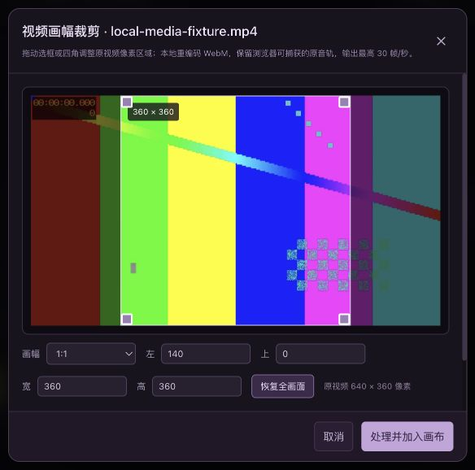

# 本地视频画幅裁剪

工具箱「视频 → 画幅裁剪」使用 `LocalMediaEditor` 的 `crop` 模式。可拖动选框及四角，选择自由、原比例、16:9、1:1、9:16、4:3，或填写原视频坐标下的左、上、宽、高像素值。输入像素值会切换到自由比例。时长范围仍可单独设置。

输出不是样式遮罩：每个解码帧通过 `drawImage` 将指定源矩形绘制到对应尺寸的 Canvas；Canvas 捕获的视频轨与原视频捕获的音轨合并，再交由 MediaRecorder 编码为 WebM。结果通过现有来源绑定流程新增媒体节点。无云端请求。

依赖浏览器的 `HTMLMediaElement.captureStream`、`HTMLCanvasElement.captureStream` 和 WebM MediaRecorder 编码器。保留浏览器实际提供的音轨；无音轨的视频仍输出静音视频。输出最高 30 帧/秒，以实时速度处理，时间边界和实际帧率受浏览器调度影响，不是无损压缩或逐帧离线剪辑。画幅会取整到实际像素，奇数尺寸可能导致比例有不足一像素的偏差。

取消、关闭、播放失败和编码错误会终止录制，释放源流、Canvas 流、帧回调与绘图缓冲区；不会提交半成品。相关测试验证像素矩形、输出流中保留原音轨且排除原画面轨，以及失败/取消清理。这些测试模拟浏览器对象，不替代真实浏览器解码和音画同步验收。

2026-10-27 真实浏览器验收：3 秒有声音的 640×360 MP4 选择 1:1，界面区域 x=140、y=0、360×360。实际下载 WebM 经 ffprobe 确认为 360×360 VP9 + Opus，经 ffmpeg 完整解码 73 帧至 3.00 秒。撤销移除结果，重做恢复；第二次录制在约 0.34 秒取消，未新增第二个结果。未做精确音画同步或听感评估。

录制 WebM 可能缺少容器时长。共享元数据读取器在独立媒体元素上定位尾部，只接受浏览器解析得到的有限时长；不以所选区间长度代替实际输出时长。新结果提交前保存该值，旧结果在重新编辑时也可发现；超时或取消不会提交迟到结果。真实浏览器旧结果恢复为约 2.983 秒，再次裁剪的 360×270 结果保存为 3.073 秒，并可重新编辑。

